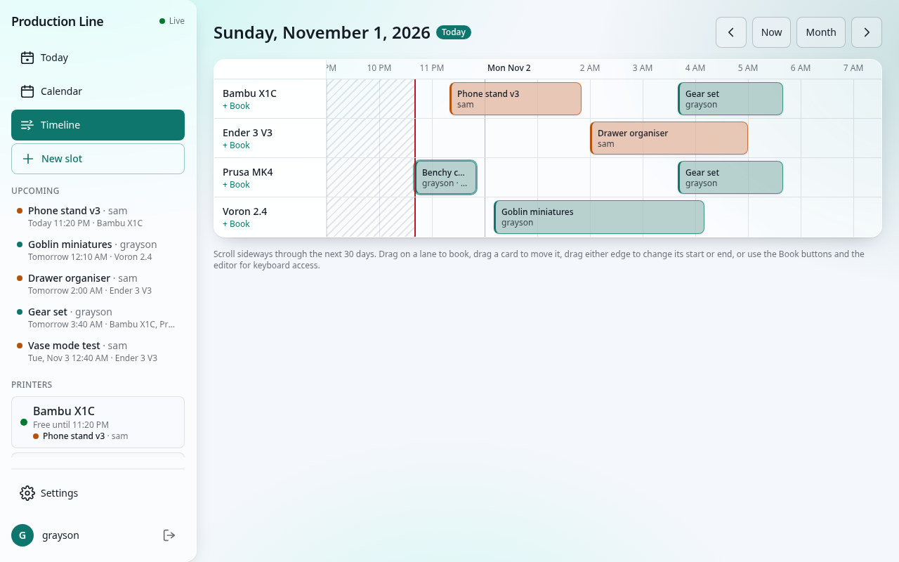
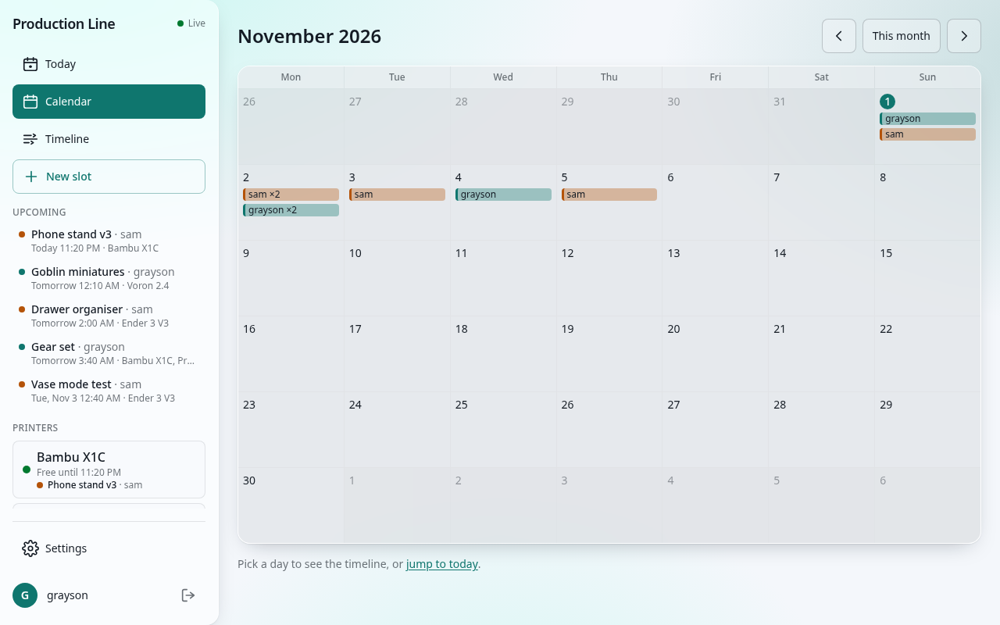
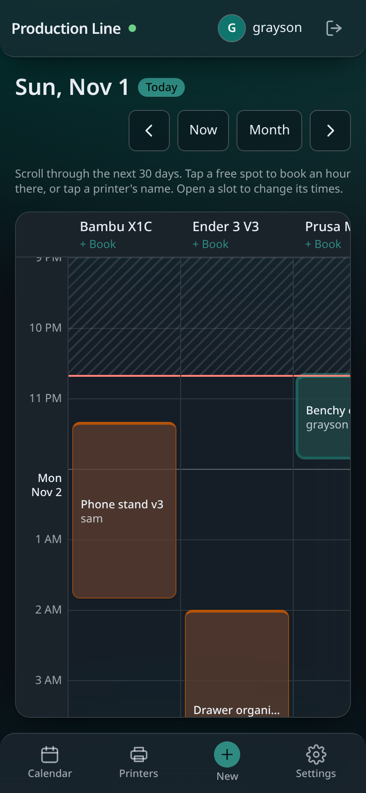

# Production Line Web

Self-hosted, LAN-only scheduling for shared 3D printers. Book time slots on one or more printers from a calendar/timeline UI, see changes in real time across every open session, and let Home Assistant know when a slot expires.

Made for a household or small workshop that shares a few printers: everyone gets an account, books the printer they need for the hours they need, and sees at a glance who is printing what. It runs on a Raspberry Pi, a NAS, or any machine with Docker or Podman, needs no cloud account, and keeps all of its data in one directory.

| Desktop timeline | Month calendar | Phone |
|---|---|---|
|  |  |  |

**Status:** release candidate. See [CHANGELOG.md](CHANGELOG.md), [docs/ROADMAP.md](docs/ROADMAP.md) for the build plan, and [docs/DEV_DOCUMENT.md](docs/DEV_DOCUMENT.md) for the full specification.

## How it works

1. The first person to open the app creates the **Owner** account. Others register themselves (the Owner can turn that off and promote **Admins**).
2. An admin adds the **printers** under Settings.
3. Anyone books a **slot**: a name, a start and end on a 5-minute grid up to 30 days ahead, and one or more printers. The server refuses overlapping bookings on the same printer, so a slot is a promise the printer is yours.
4. The **timeline** shows every printer as a lane; drag to book, move, or resize. The **calendar** gives the month. Every open browser updates live.
5. When a slot's end passes it leaves the schedule, and optionally **Home Assistant** gets an event (see [docs/HOME_ASSISTANT.md](docs/HOME_ASSISTANT.md)).

## Requirements

- Node.js 26 or newer (standalone install), or Docker / Podman (container install)

## Install

Three supported paths. All of them serve the app on port 8080, open `http://<host>:8080/` to create the Owner account on first run. Set `PLW_PORT` before running an installer to use another port. Re-running an installer upgrades in place and keeps your data; the database migrates itself on start.

### Docker Compose

```bash
curl -fsSLO https://raw.githubusercontent.com/TheGraysonHarbison/production-line-web/main/scripts/install-docker.sh
bash install-docker.sh
```

Writes `~/production-line-web/compose.yaml` (image `ghcr.io/goblinfoddergames/production-line-web`, data on the `plw-data` volume, `TZ` from the host) and runs `docker compose up -d`. Upgrade: re-run the script. Remove: `docker compose -f ~/production-line-web/compose.yaml down` (add `-v` to delete the data volume).

### Podman (rootless, Quadlet)

```bash
curl -fsSLO https://raw.githubusercontent.com/TheGraysonHarbison/production-line-web/main/scripts/install-podman.sh
bash install-podman.sh
```

Installs `~/.config/containers/systemd/production-line.container` as a user service, starts it, and enables lingering so it comes back after a reboot. `AutoUpdate=registry` lets `podman auto-update` (or its timer) pull new images. Upgrade: re-run the script. Remove: `scripts/uninstall-podman.sh` (`--purge` also deletes the `plw-data` volume).

### Standalone (servers, Raspberry Pi 4/5 with a 64-bit OS)

Needs Node 26 or newer on the `PATH` (see <https://nodejs.org/en/download>); the installer never installs Node.

```bash
curl -fsSLO https://raw.githubusercontent.com/TheGraysonHarbison/production-line-web/main/scripts/install-standalone.sh
sudo bash install-standalone.sh                      # latest release
sudo bash install-standalone.sh --version v1.0.0-rc.1
sudo bash install-standalone.sh --from-source        # from inside a git checkout
```

Creates the `plweb` system user and `/var/lib/production-line` (the data directory, mode 0750), unpacks the release tarball into `/opt/production-line-web`, installs runtime dependencies with `npm ci --omit=dev`, and installs a hardened systemd unit (`ProtectSystem=strict`, only the data directory writable, `PrivateTmp`, `NoNewPrivileges`). Logs: `journalctl -u production-line -f`. Upgrade: re-run the installer. Remove: `sudo scripts/uninstall-standalone.sh`, which keeps `/var/lib/production-line` unless you pass `--purge`.

### Environment

| Variable | Default | Purpose |
|---|---|---|
| `PORT` | `8080` | Listen port |
| `HOST` | `0.0.0.0` | Bind address |
| `DATA_DIR` | `./data` (standalone `/var/lib/production-line`, containers `/data`) | Database, secret key, images |
| `TZ` | unset | OS timezone for log timestamps; the app's timezone is set in Settings → General |
| `LOG_LEVEL` | `info` | pino level |
| `TRUST_PROXY` | `0` | Set `1` behind a reverse proxy |

## Upgrading

Re-run the installer you used. Containers pull the newest image and recreate the container; the standalone installer replaces `/opt/production-line-web` and restarts the service. The database migrates itself on start, data is never touched, and migrations are forward-only, so take a backup first if you want a way back (restore it by file replacement, below).

## Reverse proxy and HTTPS

Production Line serves plain HTTP and is meant for a trusted home LAN. For HTTPS, put Caddy or Nginx in front and start the app with `TRUST_PROXY=1` so it trusts `X-Forwarded-Proto` and the client address from the proxy. Caddy needs one line:

```
printers.example.lan {
    reverse_proxy 127.0.0.1:8080
}
```

With Nginx, pass `Host`, `X-Forwarded-For`, and `X-Forwarded-Proto`, and keep `proxy_buffering off` on `/api/stream` so live updates are not delayed. Never set `TRUST_PROXY=1` without a proxy in front: the app would then believe whatever a client puts in those headers.

## Troubleshooting

- **"setup" page never appears / the app says setup is complete.** Setup runs once, for the first account. If you lost that password, stop the app and delete `app.db` (and `app.db-wal`, `app.db-shm`) in the data directory to start over, or restore a backup.
- **Port 8080 is taken.** Set `PLW_PORT` before running an installer, or change `PORT` (standalone drop-in at `/etc/systemd/system/production-line.service.d/`, `ports:` in `compose.yaml`, `PublishPort=` in the Quadlet unit).
- **Standalone install stops at "Node.js was not found" or "does not run".** Install Node 26+ from <https://nodejs.org/en/download> so that `node` is on the `PATH` of the user running `sudo`; official Linux builds also need `libatomic1`. Version managers such as fnm or nvm install into your home directory; the installer pins the path it finds, which must stay readable by the `plweb` user.
- **"Live" shows as Offline or Reconnecting.** The browser lost the event stream; it reconnects on its own. Behind a proxy, make sure `/api/stream` is not buffered or timed out.
- **Too many requests (429).** Login is limited to 10 attempts per minute per address and everything else to 300 requests per minute per address. Wait a minute.
- **Images cannot be uploaded.** An admin must enable them under Settings → General. Files over 10 MB and types other than PNG, JPEG, TIFF, WEBP, and the listed RAW formats are refused by content, whatever the extension.
- **Home Assistant never receives events.** Use the Test button under Settings → Home Assistant and read the status it reports; `docs/HOME_ASSISTANT.md` covers tokens, URLs, and replaying failed deliveries from the log.
- **Where are the logs?** Standalone: `journalctl -u production-line -f`. Docker: `docker logs -f production-line`. Podman: `journalctl --user -u production-line -f`. Set `LOG_LEVEL=debug` for more.
- **Timezone looks wrong.** The app's display timezone is Settings → General; `TZ` only affects log timestamps.

## Development

```bash
npm ci
npm run dev      # client on :5173 (proxying /api), server on :8080
npm test         # unit + integration tests
npm run lint     # biome
npm run build    # production build into server/dist + server/public
npm start        # serve the production build on :8080
```

See [docs/CONTRIBUTING.md](docs/CONTRIBUTING.md) for details.

## Images

An admin can turn on image uploads under **Settings → General**. Slots then accept photos (PNG, JPEG, TIFF, WEBP, and camera RAW: DNG, CR2, CR3, NEF, ARW, RAF, ORF, RW2) up to 10 MB each, and everyone can set a profile image. Files are checked by their actual bytes, stored under `DATA_DIR/images/`, and deleted with the slot. Browsers can't display TIFF or RAW, so those appear as a file card with a download link.

## Backups

**Settings → Backup** (admin) downloads a consistent copy of the database as `production-line-YYYYMMDD-HHMM.db`. It holds users, printers, slots, and settings, but not images. To restore: stop the app, replace `app.db` in the data directory with the file (removing any `app.db-wal` / `app.db-shm` beside it), and start the app again. If `secret.key` was lost too, re-enter the Home Assistant token.

## Home Assistant

When a slot ends, the server can fire a `production_line_slot_expired` event at your Home Assistant instance so automations can react (a notification, a smart plug, a light). Setup takes a long-lived token and the instance URL under Settings → Home Assistant, with a Test button. [docs/HOME_ASSISTANT.md](docs/HOME_ASSISTANT.md) has the walkthrough, the event payload, example automations, and how to replay failed deliveries.

## License

MIT
